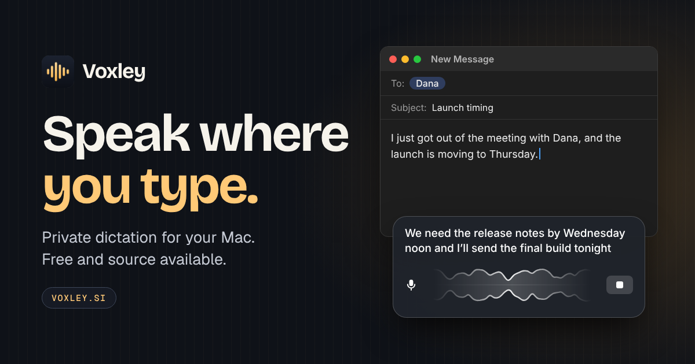
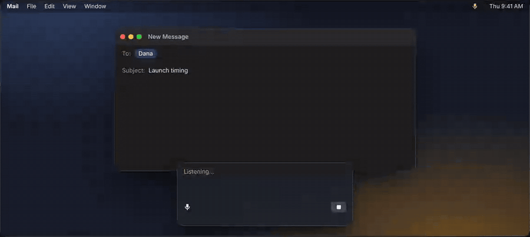
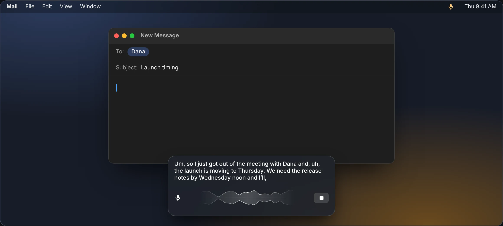
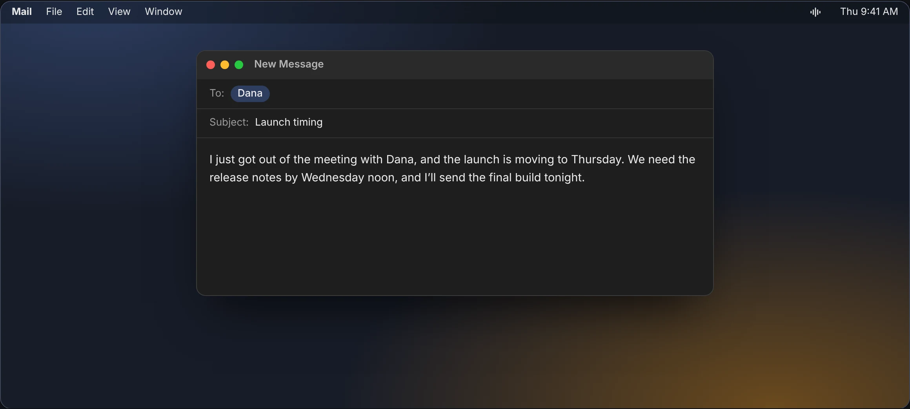
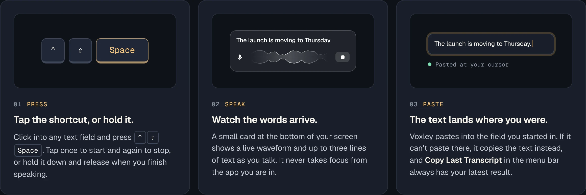
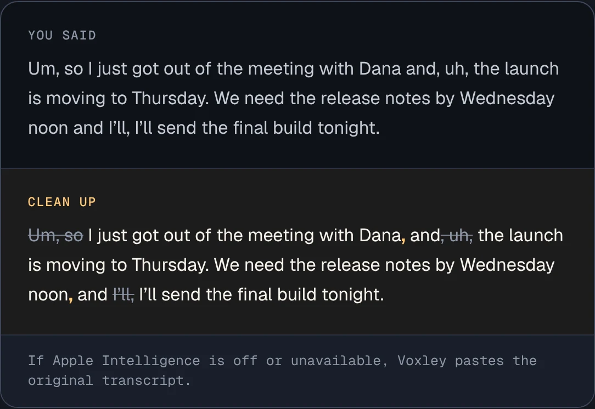

<p align="center"></p>

<p align="center"><strong>Private dictation for your Mac. Free and source available.</strong><br>Press a shortcut in any app, say what you mean, and the words are pasted at your cursor.</p>

<p align="center"><a href="https://voxley.si/download/"><strong>Download for Mac</strong></a> · <a href="#build-it-yourself">Build it yourself</a> · <a href="https://voxley.si/">Visit voxley.si</a></p>

<p align="center"><sub>Free · Apple silicon · macOS 26 or later · Signed by Protomota and notarized by Apple</sub></p>

---

## Speak where you type

Voxley lives in the menu bar and stays out of the way until you call it. Click into any text field, press **Control–Shift–Space**, and talk. A small card at the bottom of the screen shows a live waveform and your words as they arrive. Stop, and the text lands where you were.

<p align="center"></p>

Apple Speech transcribes on your Mac. Apple Intelligence can tidy the text if you want it to. There is no server, no account, no API key, and no third-party model.

<table>
<tr><th>While you speak</th><th>When you stop</th></tr>
<tr>
<td></td>
<td></td>
</tr>
<tr>
<td>Up to three lines of live text, with the waveform between the mic and Stop. The card never takes focus from your app.</td>
<td>Voxley pastes into the field you started in. If it can’t, it copies the text, and <strong>Copy Last Transcript</strong> always has your latest result.</td>
</tr>
</table>

## Press, speak, keep typing



## Say it once. Keep it or tidy it.

Voxley starts in **Verbatim**, which keeps exactly what Apple Speech heard. Pick another mode and Apple Intelligence edits the transcript on your Mac before it is pasted.

<p align="center"></p>

| Mode | What you get |
| --- | --- |
| **Verbatim** | The transcript as spoken, with no AI rewrite. |
| **Clean up** | Obvious filler removed, punctuation and casing fixed. Your meaning and voice stay the same. |
| **Notes** | Concise notes, with bullets where they help. Facts, names, and action items are kept. |
| **Email** | A clear email body in your tone. It never invents a subject, greeting, or signature. |

## Teach it how you talk

| | |
| --- | --- |
| **A mode for each app** | Mail can get Email and your notes app can get Notes, while everything else keeps your default. |
| **Replacements** | Say one thing and write another. Whole-word matches in any casing, so a name is spelled your way every time. |
| **Vocabulary hints** | List names and uncommon words. Apple Speech uses them as hints while it listens. |
| **Your own shortcut** | Any key with a modifier, or a function key. Voxley checks that it hears both the press and the release. |
| **Your language** | Any language Apple Speech supports on your Mac. The first dictation in a new language can take longer while macOS installs it. |
| **History you control** | A local text history so a transcript is never lost. Turn it off in Settings to stop saving new entries. |
| **Backup and restore** | Export settings, dictionary, app modes, and history to one JSON file. Restore merges transcripts without duplicates. |
| **Automatic updates** | The direct-download build uses Sparkle for signed updates. Turn automatic installation off in **Settings → General → Updates**. |

## Your voice stays on your Mac

- **Transcribed on device.** Apple Speech’s `SpeechAnalyzer` and `SpeechTranscriber` turn audio into text on your Mac. Voxley has no server to send it to, and it does not keep recordings.
- **No account.** Nothing to sign in to and no API key to paste.
- **Optional cleanup, also on device.** Text cleanup uses Apple Intelligence’s on-device Foundation Model.
- **Your backups are readable.** A backup contains transcript text, so keep it somewhere safe. Sparkle uses its own preferences and does not send dictation data.

<sub>The images above are captures of the scripted preview on [voxley.si](https://voxley.si/), which reproduces the Voxley recorder with example text.</sub>

## Get started

1. [Download Voxley](https://voxley.si/download/), open the disk image, and drag Voxley onto Applications.
2. Launch Voxley and look for the waveform icon in the menu bar. Choose **Voxley Onboarding… → Permissions** and click **Allow Microphone**. If you denied it before, turn Voxley on in [Microphone privacy settings](x-apple.systempreferences:com.apple.preference.security?Privacy_Microphone).
3. Under **Automatic paste**, click **Open System Settings** and turn on Voxley in [the privacy pane](x-apple.systempreferences:com.apple.preference.security?Privacy_Accessibility). If Voxley isn’t listed, click **+**, press **⌘⇧G**, enter `/Applications/Voxley.app`, and click **Open**. Return to Voxley and click **Check Permissions Again**.
4. Under **Practice dictation**, click the field and dictate the sample phrase. **Test Paste** checks pasting separately from the microphone and shortcut. Practice phrases are not saved to history.
5. To use a different shortcut, open **Keyboard shortcut → Record Shortcut…** and press the combination. Common editing commands such as **Command–V** are reserved. Press **Escape** to cancel.

For text cleanup, check **Apple Intelligence** in Voxley Settings. If it is off, enable it in [Apple Intelligence & Siri settings](x-apple.systempreferences:com.apple.Siri-Settings.extension) and wait for the model to become available.

## Build it yourself

Voxley is a Swift package. You need an Apple silicon Mac with macOS 26 and Xcode 27 or later.

```sh
swift build
swift test
```

Or open `Package.swift` in Xcode. To build a launchable app bundle with the microphone usage description and a local code signature, use the scripts below. They are Protomota’s packaging workflow and expect a volume mounted at `/Volumes/Expand`, where build products and the synthetic test audio go.

```sh
./Scripts/build-app.sh
./Scripts/test-app.sh
./Scripts/test-app.sh --with-models
```

To sign the first build with a Developer ID, set `VOXLEY_SIGNING_IDENTITY` to the signing identity in your login keychain. Later builds reuse the Developer ID from the existing app so macOS recognizes the same app across updates. When moving from an ad-hoc build to a Developer ID build, grant Microphone and Automatic Paste to the signed app once.

<details>
<summary><strong>Package the direct-download installer</strong></summary>

<br>

```sh
build_tools='/Volumes/Expand/Codex Media/Voxley/Build/dmg-tools'
release_dir='/Volumes/Expand/Codex Media/Voxley/Release/<version>'
python3.12 -m venv "$build_tools"
"$build_tools/bin/python" -m pip install -r Packaging/macOS/requirements.txt
VOXLEY_RELEASE=1 VOXLEY_SIGNING_IDENTITY='Developer ID Application: Protomota, LLC (22HV69L32T)' \
  ./Scripts/build-app.sh "$release_dir"
./Scripts/release-dmg.sh "$release_dir" --keychain-profile "$NOTARYTOOL_PROFILE"
```

Use a fresh release directory and a higher `CFBundleVersion` for each update. The packaging script makes the branded drag-to-Applications DMG, verifies its mounted contents, signs and notarizes it, and generates the signed `appcast.xml` after stapling. It uses the `voxley-direct` Sparkle signing identity and verifies that its public key matches the app. The private signing key stays in the macOS Keychain.

To publish an approved release, serve the exact stapled DMG under `https://voxley.si/downloads/` and its signed feed at `https://voxley.si/appcast.xml`. Publish the DMG before the feed. Editing a signed feed or changing the DMG bytes requires regenerating the signatures.

</details>

## Source availability

Copyright © 2026 Protomota, LLC. The source is available to inspect. Third-party components retain their own licenses.

---

<p align="center"><a href="https://protomota.com/"></a><br><sub>Voxley is a <a href="https://protomota.com/">Protomota</a> product · <a href="https://newsletter.protomota.com/">Newsletter</a> · <a href="https://buymeacoffee.com/protomotalab">Buy me a coffee</a></sub></p>
